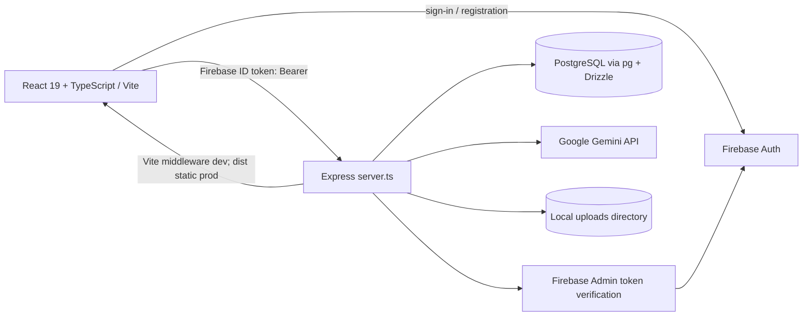
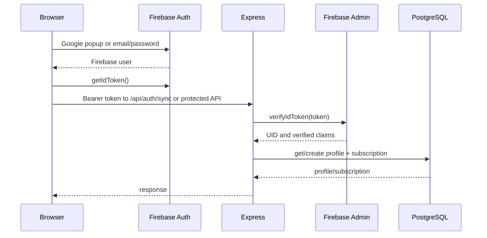
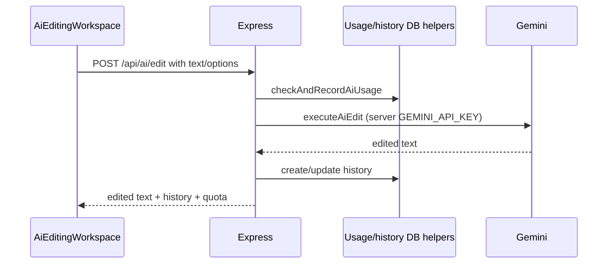
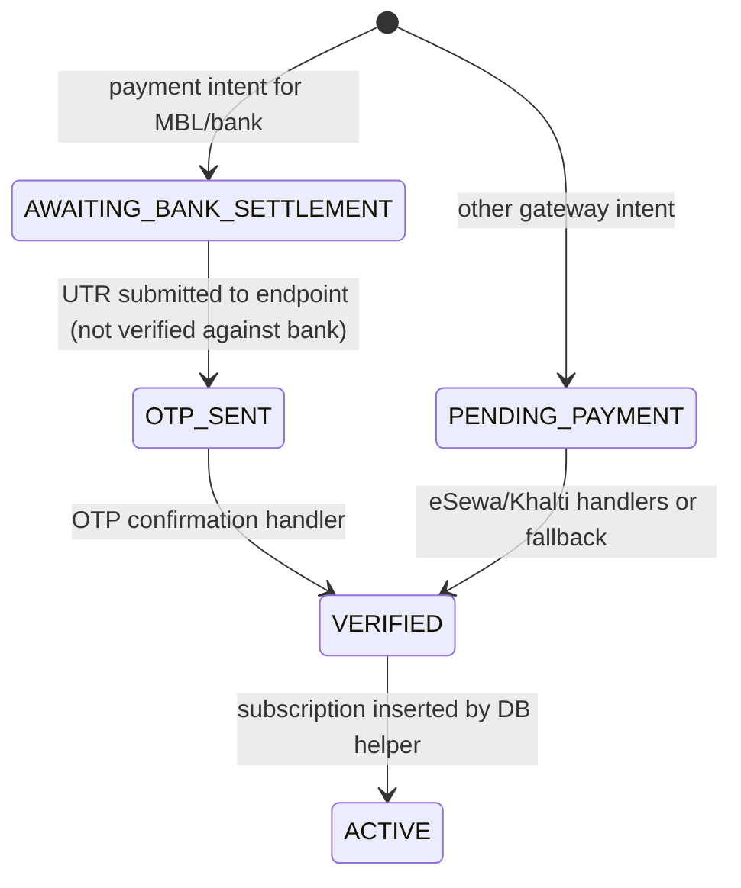

# ShikshyaStudio Architecture

**Evidence snapshot:** `main` commit `373e1ff893cca5584a0ed7dd8f266c39a8348855`, inspected 2026-11-01. Diagrams describe source code, not live production behavior.

## System shape

The browser state is React Context plus component state; app view switching is local state in `src/App.tsx`, not a URL router. Shared contexts: `src/context/AuthContext.tsx`, `LanguageContext.tsx`, `ThemeContext.tsx`. Styling is utility-oriented Tailwind CSS and inline utility classes; global styles are `src/index.css`.

## Startup and HTTP routes

`server.ts` loads dotenv, Express JSON/urlencoded middleware, configures Multer, initializes local upload folders, then starts listening on `PORT` (default 3000). Development mounts Vite middleware. Production serves `dist` and falls back to `index.html`. Startup attempts to seed demo users and projects.

Observed endpoint groups:

| Routes | Purpose | Auth observed |
|---|---|---|
| `POST /api/auth/sync`, `GET /api/auth/me`, `PUT /api/auth/profile` | Sync/read/update profile | `requireAuth` |
| `POST /api/auth/signup`, `/login`, `/verify-email`, `/resend-code` | Legacy/demo account & email code flow | No `requireAuth` |
| `GET/POST /api/projects`, `GET/PUT/DELETE /api/projects/:id` | User-scoped project APIs | `requireAuth` |
| `POST /api/media/upload` | Store audio/video upload locally | `requireAuth`, Multer 100 MiB limit, broad audio/video MIME check |
| `POST /api/projects/:id/generate-ai-pack` | Gemini lesson pack, or existing pack fallback | `requireAuth`, `requireActiveSubscription` |
| `POST /api/ai/edit` | Gemini text editing, quota and history | `requireAuth`; usage quota checked in handler |
| `/api/ai/extract-document`, `/history`, `/history/:id`, `/usage`, `/export` | Document extraction, editing history, usage, export | Most routes use `requireAuth`; document extract is authenticated |
| `/api/downloads/generate-signed-link` | Create 15-minute signed link | `requireAuth` + project ownership lookup |
| `GET /api/downloads/signed/:token` | Return subtitle/lesson file or redirect/media placeholder | Signature+expiry only; no Firebase auth middleware |
| `/api/payments/initiate`, `/mbl/verify-settlement`, `/mbl/confirm-otp`, `/verify-esewa`, `/verify-khalti`, `/transactions` | Payment intent, purported verification, OTP, subscription | `requireAuth` |

The full route implementations are in `server.ts`; authorization details and shortcomings are documented in `SECURITY.md`.

## Authentication and profile flow

Firebase web configuration is statically imported from `firebase-applet-config.json`; server Admin SDK initializes using the configured Firebase project ID and default application credentials. The client persists token and user snapshots in `localStorage`. Separately, server middleware treats tokens prefixed `shikshya-token-` as trusted demo identity tokens. Legacy unprotected routes issue those tokens without real password verification; do not merge this demo path with the Firebase flow.

## Database model

`src/db/schema.ts` declares PostgreSQL Drizzle tables:

- `profiles`: Firebase UID primary key, unique email, role/contact/profile fields.
- `subscriptions`: user FK, plan/status/billing cycle and start/expiry timestamps.
- `payments`: user FK, optional subscription FK, amount/method/reference/invoice/state/verification data.
- `otps`: user/payment FKs, hashed OTP, purpose, expiry, verified flag and attempts.
- `projects`: user FK and project/media/processing/subtitle/lesson pack JSON data.
- `editing_history`: user-owned input/output/instruction/mode/count history.
- `ai_usage_logs`: user-associated operation and metering information.

Connection is `src/db/index.ts`, using environment values `SQL_HOST`, `SQL_USER`, `SQL_PASSWORD`, `SQL_DB_NAME` and a `pg` pool. Drizzle schema tooling is configured in `src/db/drizzle.config.ts`; no migration artifacts were present in the repository tree. DB helper functions are in `src/db/users.ts`, `projects.ts`, and `editingHistory.ts`.

## AI editing and documents

`src/services/aiEditorService.ts` constructs system/mode instructions and splits long text at paragraph boundaries before Gemini calls. `src/components/AiEditingWorkspace.tsx` supplies modes, strength, tone, target language, comparison/history, document upload and export UI. A failed edit can occur after usage has been recorded. Document upload goes through `/api/ai/extract-document`; `src/services/documentExtractor.ts` extracts TXT/MD/CSV, DOCX with Mammoth, or PDF with pdf-parse; server attempts to remove the temporary document afterward.

Exam pack generation in `server.ts` is another Gemini request using project metadata/subtitle content. Without the key, or after caught generation errors, it returns the existing pack as a successful fallback. The new project route seeds example lesson packs and subtitles, so those are not evidence of transcription or AI generation.

## Audio, captions and media

`src/utils/audioHelper.ts` uses browser audio APIs for buffer analysis and silence segments and includes SRT/VTT and lesson-pack formatting helpers. `UploadModal` can upload an audio/video file, then create a project. `server.ts` stores upload bytes under `uploads/media` and returns metadata. But the upload UI may continue with a public sample URL when absent/failed; project creation assigns preset keep ranges, subtitles and lesson pack. `AudioProcessorView` saves parameter metadata (silence threshold, normalization target, trim seconds); no server media renderer/transcoder or transcription provider is present in the tree. `SubtitleEditorView` edits pre-existing cues and supports save/export; no speech-to-text generation path was found.

## Payment state path (intended versus implemented)

This diagram shows code transitions, not trustworthy settlement. No bank/gateway verification API or webhook configuration is present. The MBL endpoint validates a supplied UTR's length and stores it, rather than querying a bank. eSewa/Khalti error paths fabricate successful responses. OTP is returned to the caller, and the database helper accepts a universal demo OTP. The payment and OTP helpers call an unimported `neq` function (only `eq`, `and`, `desc` are imported), so those functions throw at runtime as written. Refer to `SECURITY.md`; don't rely on these states operationally.

## Deployment evidence and unknowns

The repository has AI Studio metadata and `.env.example` comments about AI Studio injecting `GEMINI_API_KEY` and `APP_URL`, but no Dockerfile, Cloud Build config, Cloud Run YAML, deploy workflow or domain config is in the tree. `APP_URL` appears in the example only; Firebase authorized domains and Cloud Run settings are not repository-verifiable. The user-provided AI Studio app URL is not proof that the named domain is active. See `PROJECT_CONTEXT.md` for build/start scripts and limits.